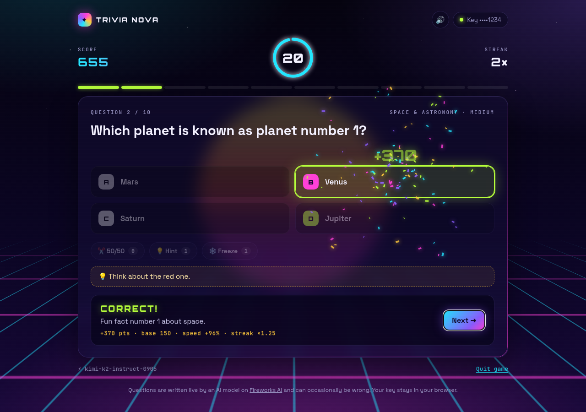
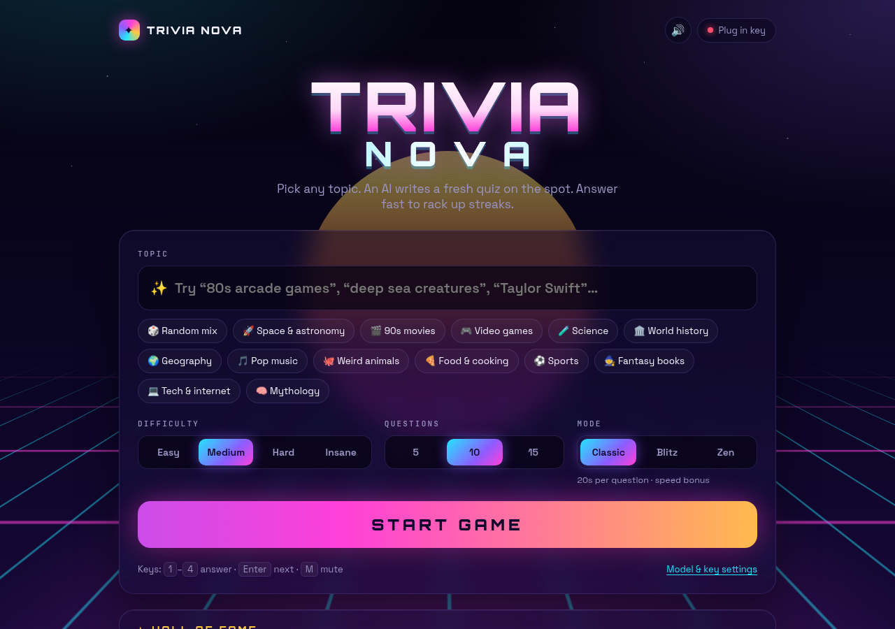

# TRIVIA NOVA

AI trivia on any topic in a retro-synthwave arcade UI. Type a topic (or pick one), and a Fireworks AI model writes a new quiz while you play.

## Play

1. Open `index.html` in a browser. It's a single file with no build step; GitHub Pages works too.
2. Click **Plug in key** and paste your [Fireworks AI API key](https://app.fireworks.ai/settings/users/api-keys). The key is stored only in your browser and is only sent to `api.fireworks.ai`.
3. Pick a topic, difficulty, number of questions and mode, then hit **START GAME**.

## Features

- **Any topic.** Questions are streamed from the model as JSON lines, so the first one shows up while the rest are still being written.
- **Modes:** Classic (20s, speed bonus), Blitz (8s, double points) and Zen (no timer).
- **Difficulty:** Easy, Medium, Hard and Insane, each with its own score multiplier.
- **Lifelines:** 50/50, Hint and Freeze (stops the clock).
- **Scoring:** speed bonus plus a streak multiplier. Correct answers get confetti and sound effects (press `M` to mute).
- **Results screen:** a grade from S to F, a sign-off line from the AI host, a question-by-question review and a shareable 🟩🟥 summary.
- **Local storage:** a Hall of Fame leaderboard, plus a list of past questions per topic so replays avoid repeats.
- **Model picker:** choose any chat model on your Fireworks account. The default is `kimi-k2-instruct-0905`.
- **Keyboard:** `1`–`4` or `A`–`D` to answer, `Enter` for the next question.

> Questions are AI-generated and can occasionally be wrong.
